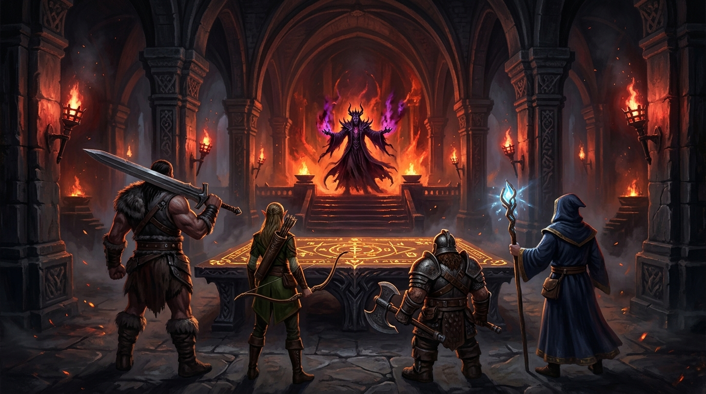

# ⚔️ HeroQuest: Crónicas del Abismo
### Estudio Digital para Dungeon Master & Hoja Móvil QR · **Sistema HQ-D20 v2**

**Asistente táctico y narrativo para jugar HeroQuest en mesa física con miniaturas y dados reales, potenciado con mecánicas D20, campaña persistente y sincronización en vivo con los celulares de tus jugadores.**

### 👉 [⬇️ DESCARGAR ÚLTIMA VERSIÓN (INSTALADOR 1-CLIC)](https://github.com/xZATANAZx/heroquest-cronicas-del-abismo/releases/latest)

---

## 🌟 ¿De qué trata este proyecto?

**HeroQuest: Crónicas del Abismo** mantiene la magia del juego de mesa físico —mover miniaturas sobre el tablero real y tirar dados físicos en la mesa— mientras el **DM** controla todo desde su PC y cada **aventurero (1 a 4 héroes)** lleva su hoja interactiva en su celular escaneando un código QR.

> 🛡️ **Privacidad de partidas:** Cada computadora guarda sus propios personajes y su propia campaña de forma 100% independiente. Si instalas el programa en otra PC, **arranca completamente limpio**, y cuando se publican actualizaciones **se actualiza solo sin borrar jamás tus héroes ni tu progreso**.

---

## 🔥 Novedades y Todo lo que Puedes Hacer

| Módulo | Qué incluye |
| :--- | :--- |
| 🗺️ **Tablero Táctico 2D (26×19)** | Plano estilo Libro de Misiones con guía exacta de montaje por sala, narrativa oficial para leer en voz alta, **Iniciativa Sorpresa/Física**, Salas de Peligro, Pasillos con Vida, trampas clicables y envío directo de botín/materiales al celular. |
| 📜 **18 Misiones Oficiales + Generador Infinito** | Campañas oficiales reestructuradas (*Juego Base*, *Reina de los Espíritus*, *Luna del Terror*), generador procedural de mazmorras, arcos de campaña, **Modo Defensa por Oleadas (5 Oleadas)** y **Cámara de Alquimia** protegida. |
| 🛡️ **Modo 1 Jugador Solitario y Escalado 1–4 Héroes** | Rebalancea en vivo la cantidad de enemigos, PC, Ataque, Defensa y CD del tablero y del bestiario para disfrutar desde **1 aventurero solitario** hasta **4 héroes**. |
| 🧙 **Forja de Personajes (16 Razas · 18 Clases)** | Creación profunda y balanceada con roles de equipo (*Tanque, Soporte, DPS, Híbrido*), subclases, progresión por niveles, habilidades D20 con uso táctico real y hoja sincronizada al celular. |
| 🏛️ **Ciudad Interactiva en Vivo para Celulares** | El DM abre la Ciudad y cada jugador entra desde su teléfono a los 6 distritos: **Taberna y Contratos con Votación en Vivo**, **Forja de Equipo por Rareza (Solo Ciudad)**, **Reciclaje de Equipo**, **Alquimia con tirada física d20 de Arcano**, **Templo**, **Banco**, **Gremio de Profesiones**, **Familiares** y **Eventos de Ciudad interactivos** (individuales o grupales). |
| 🧭 **Sistema de Viajes de Rol (Sin Tablero)** | Al regresar a la Ciudad, ocurren encuentros narrativos de rol con decisiones, tiradas físicas d20, NPCs, trampas y recompensas sin tener que montar el tablero. |
| 👹 **Bestiario Dinámico Escalable** | 21 monstruos con auto-escalado por nivel (Nv. 1–10) y tamaño de grupo (1–4 héroes), plantillas en 1 clic, Modo Élite, Modo Espíritu (daño a PM) y calculadora de amenaza. |
| 📱 **Conexión QR Instantánea (Local + Internet)** | Modal `Conectar` con túnel seguro HTTPS automático (Cloudflare) y modo Wi-Fi local para que cualquier celular entre al Lobby y cree o elija su personaje en segundos. |

---

## 🚀 Instalación en 1 Clic (Windows)

1. Ve a la sección de [**Releases (Última Versión)**](https://github.com/xZATANAZx/heroquest-cronicas-del-abismo/releases/latest) y descarga **`INSTALAR_HEROQUEST_DM.bat`**.
2. Dale **doble clic** a `INSTALAR_HEROQUEST_DM.bat`.
   - Si no tienes Node.js, lo instala automáticamente.
   - Descarga la versión limpia en `Escritorio\HeroQuest_DM` y crea el acceso directo **`HeroQuest DM`** en tu Escritorio.
3. ¡Listo! Cada vez que abras **`HeroQuest DM`** (`ABRIR_HEROQUEST_DM.bat`):
   - **Se actualiza solo** si hay una nueva versión disponible.
   - **Nunca borra** tus héroes (`.hq_data/`) ni tu progreso de campaña.
   - Abre el Panel del DM y te permite conectar los celulares con el botón **`📱 Conectar`**.

---

## 📦 Releases y Registro de Cambios

Todas las versiones oficiales y sus cambios detallados se publican en la pestaña [**Releases**](https://github.com/xZATANAZx/heroquest-cronicas-del-abismo/releases).

### 🏷️ `v2.2.0` — Tablero Moderno 2021 e Iconos Oficiales de HeroScribe
- 🗺️ **Tablero Moderno 2021 exacto (`26×19`, 22 salas reales):** incluye las 2 salas gemelas `2×3` y la sala en "L" de 15 casillas con paleta crema/piedra/borgoña.
- 🪑 **Dimensiones reales de muebles en misiones oficiales y procedurales:** `3×2` (Mesa, Mesa de Alquimista, Mesa de Hechicero, Tumba, Potro de Tortura), `3×1` (Biblioteca, Alacena, Chimenea, Estante de Armas), `2×2` (Escaleras) y `1×1` (Trono, Cofre, Trampas).
- 🎨 **30 iconos oficiales open-source de HeroScribe (GPL-2.0)** en el tablero, en la leyenda visual y en el apartado de **Preparación Previa (Caja Física)** para identificar al instante cada mueble y miniatura.

### 🏷️ `v2.1.0` — Buzón de Sugerencias y Reporte de Bugs
- 💬 Nuevo botón **`Sugerencias`** en la barra superior para enviar reportes de bugs, ideas nuevas, qué mejorar/renovar, qué gustó o qué quitar directamente al creador (sin necesitar cuenta ni registro).
- 👑 Panel privado exclusivo del creador para gestionar la hoja de ruta de mejoras pendientes.

### 🏷️ `v2.0.0` — Crónicas del Abismo (Lanzamiento Oficial HQ-D20 v2)
- ✨ Lanzamiento completo del sistema **HQ-D20 v2** para mesa física (1–4 aventureros + DM).
- ✨ **Auto-actualizador integrado** en `ABRIR_HEROQUEST_DM.bat` e instalador en 1 clic `INSTALAR_HEROQUEST_DM.bat`.
- ✨ **Eventos de Ciudad interactivos** con botones de resolución directa (individual o grupal) y economía de oro rebalanceada.
- ✨ **Tablero Táctico profesional y compacto** con narrativa inicial para leer en voz alta, Iniciativa Sorpresa y escalado 1–4 héroes.
- ✨ **Sistema de Viajes de Rol**, **Ciudad en vivo en celulares**, **Votación de Contratos**, **Forja por Rareza**, **Reciclaje de Equipo** y **Alquimia con tirada d20**.

---

  Hecho con pasión para sesiones inolvidables de mesa física · <strong>HeroQuest: Crónicas del Abismo</strong>

